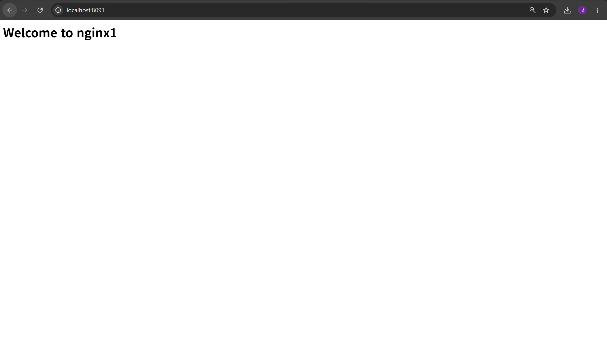
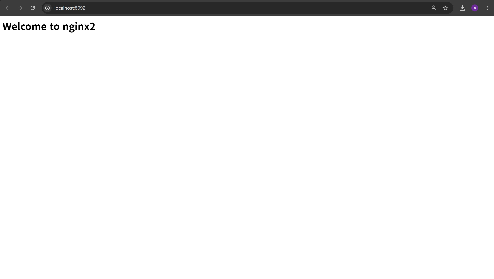
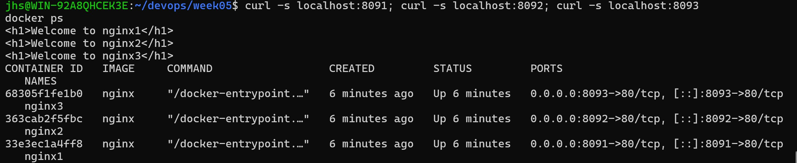

# 5주차 - Docker

## 1. 실습 개요

이번 주에는 Docker Desktop을 설치하고 nginx 컨테이너를 직접 실행해 봤다.
컨테이너 안의 파일을 수정해 보고, 같은 코드를 다른 파이썬 버전 컨테이너에서 실행해 비교했다.
실습 과정은 GitHub Issue #3으로 만들어 관리하고 PR #4로 합쳤다.

## 2. 학습 내용

### VM과 컨테이너

VM은 하이퍼바이저 위에 게스트 OS를 통째로 올리기 때문에 무겁다.
컨테이너는 호스트의 리눅스 커널을 같이 쓰고, 필요한 프로그램과 환경만 묶어서 실행하기 때문에 가볍고 빨리 뜬다.
대신 커널을 공유하기 때문에 VM보다 격리 수준은 낮다.

### 이미지와 컨테이너

교안에서는 이미지를 붕어빵 틀, 컨테이너를 붕어빵에 비유했다.
이미지 하나로 컨테이너를 여러 개 만들 수 있고, 컨테이너 안에서 무엇을 바꿔도 이미지는 바뀌지 않는다.
그래서 컨테이너를 삭제하면 안에서 수정한 내용도 같이 사라진다.

### 자주 쓴 명령어

```bash
docker run -d -p 8080:80 --name web nginx   # 백그라운드 실행 + 포트 연결 + 이름 지정
docker ps                                   # 실행 중인 컨테이너
docker ps -a                                # 멈춘 것까지 전부
docker logs web                             # 로그 확인
docker exec -it web bash                    # 컨테이너 안으로 들어가기
docker stop web                             # 정지
docker rm -f web                            # 강제 삭제
docker images                               # 이미지 목록
```

`-p 8080:80`은 내 컴퓨터 8080번으로 들어온 요청을 컨테이너의 80번으로 보낸다는 뜻이다.
4주차에 배운 포트 개념이 여기서 쓰였다.

### 유용한 옵션

- `-e` : 환경 변수를 넣는다. `docker exec env_test env | grep MY_NAME`으로 들어간 것을 확인했다.
- `-it` : 컨테이너 안에서 직접 명령을 칠 수 있게 연다.
- `--rm` : 실행이 끝나면 컨테이너를 자동으로 지운다.

### 파이썬 버전 비교

`match-case` 문법은 파이썬 3.10부터 지원된다.
`test.py`를 3.9와 3.12 컨테이너에서 각각 실행해 봤다.

```bash
docker run --rm -v "$PWD:/app" -w /app python:3.9-slim python test.py    # SyntaxError
docker run --rm -v "$PWD:/app" -w /app python:3.12-slim python test.py   # two
```

`-v`로 현재 폴더를 컨테이너의 `/app`에 연결하고 `-w`로 작업 위치를 정했다.
내 컴퓨터에 파이썬을 버전별로 설치하지 않아도 테스트할 수 있다는 점이 편했다.

## 3. 실습 결과

### 기본 실습

- `docker --version` → `Docker version 29.8.0, build 88096ef`
- `docker run hello-world` → `Hello from Docker!` 출력
- `curl -I http://localhost:8080` → `HTTP/1.1 200 OK`, `Server: nginx/1.31.6`

각 결과는 `docker-version.txt`, `docker-run-hello-world.txt`, `curl-result.txt` 등으로 저장했다.

### 혼자서 해보기

nginx 컨테이너 3개를 8091, 8092, 8093 포트로 띄우고,
`docker exec`로 각각 들어가서 `index.html`을 다르게 수정했다.

```bash
docker run -d -p 8091:80 --name nginx1 nginx
docker exec -it nginx1 bash
echo "<h1>Welcome to nginx1</h1>" > /usr/share/nginx/html/index.html
```

브라우저 확인 결과

| nginx1 (8091) | nginx2 (8092) | nginx3 (8093) |
|---|---|---|
|  |  |  |

curl과 docker ps 확인 결과



같은 nginx 이미지로 만든 컨테이너인데도 각자 다른 페이지를 보여줬다.
컨테이너끼리 서로 독립되어 있다는 걸 직접 확인할 수 있었다.
실습이 끝난 뒤에는 `docker rm -f`로 컨테이너를 정리했다.

## 4. Issue로 실습 관리

이번 주부터 실습을 GitHub Issue로 관리했다.

1. Issue #3에 목표와 완료 조건을 체크박스로 작성했다.
2. 이슈 전용 브랜치를 만들어 작업했다.
3. 실습 결과를 README에 기록하면서 체크박스를 하나씩 채웠다.
4. PR #4 본문에 `Close #3`을 적고 squash merge 했다.
5. merge가 되자 Issue #3이 자동으로 닫혔다.

완료 조건

- [x] `docker --version` 정상 출력
- [x] `docker run hello-world` 실행
- [x] `web`이라는 이름으로 nginx 컨테이너 실행
- [x] 브라우저 또는 `curl`로 `http://localhost:8080` 응답 확인
- [x] `docker ps`에서 실행 상태를 확인
- [x] 실습 결과를 `week05/README.md`에 기록
- [x] 수업에서 만든 컨테이너 정리
- [x] 혼자서 해보기 완료

## 5. 파일 구성

```
week05/
├── README.md
├── test.py                      # match-case 예제
├── docker-version.txt
├── docker-info.txt
├── docker-run-hello-world.txt
├── curl-result.txt
├── docker-ps.txt
└── images/                      # 혼자서 해보기 캡처
```

## 6. 느낀 점

명령어 한 줄로 웹 서버가 바로 뜨는 게 신기했다.
컨테이너를 지우면 수정한 내용이 사라지는 걸 보고, 바꾼 내용을 남기려면 이미지를 직접 만들어야겠다는 생각이 들었다.
