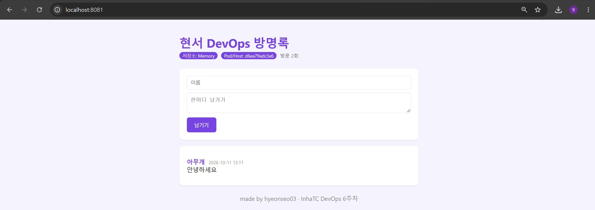

# Week 06 · Dockerfile & ghcr.io 배포

## 내 이미지

```bash
docker run -d -p 8080:5000 ghcr.io/hyeonseo03/guestbook:v2
```

- 이미지 주소: `ghcr.io/hyeonseo03/guestbook:v2`
- 패키지: https://github.com/hyeonseo03?tab=packages



## 커스터마이징

- Dockerfile ENV: 제목 `현서 DevOps 방명록`, 테마색 `#7C3AED`
- index.html: 빈 방명록 문구 변경, 배경색 변경, footer 추가
- app.py 기본값보다 ENV가 우선이라 Dockerfile을 수정했다

## 배포 과정

```bash
docker build -t guestbook:v2 .
docker run -d -p 8081:5000 --name gbv2 guestbook:v2
gh auth token | docker login ghcr.io -u hyeonseo03 --password-stdin
docker tag guestbook:v2 ghcr.io/hyeonseo03/guestbook:v2
docker push ghcr.io/hyeonseo03/guestbook:v2
```

## Dockerfile 설명

| 명령어 | 하는 일 |
|---|---|
| `FROM python:3.12-slim` | 파이썬 3.12 가벼운 이미지를 기반으로 시작 |
| `WORKDIR /app` | 작업 폴더를 /app으로 지정 |
| `COPY requirements.txt .` | 라이브러리 목록만 먼저 복사 (캐시 활용) |
| `RUN pip install ...` | 빌드할 때 라이브러리 설치 |
| `COPY . .` | 나머지 코드 복사 |
| `RUN useradd -m appuser` | 일반 사용자 생성 |
| `ENV APP_TITLE / THEME_COLOR` | 제목, 색 기본값 설정 |
| `EXPOSE 5000` | 5000번 포트를 쓴다고 표시 (실제로 열리진 않음) |
| `USER appuser` | root가 아닌 사용자로 실행 |
| `CMD ["python", "app.py"]` | 컨테이너 시작할 때 앱 실행 |

## 빌드 캐시 로그

index.html만 고치고 다시 빌드했을 때

```text
=> CACHED [2/6] WORKDIR /app
=> CACHED [3/6] COPY requirements.txt .
=> CACHED [4/6] RUN pip install --no-cache-dir -r requirements.txt
=> [5/6] COPY . .
=> [6/6] RUN useradd -m appuser
```

requirements.txt를 코드보다 먼저 복사해서 코드만 고치면 pip install은 CACHED로 넘어가고 `COPY . .`부터 다시 빌드된다.

## 설정을 넣는 세 가지 방법

| 방법 | 언제 정해지나 | 바꾸려면 |
|---|---|---|
| app.py 기본값 | 코드 작성 시 | 코드 수정 후 재빌드 |
| Dockerfile ENV | 이미지 빌드 시 | 재빌드 |
| docker run -e | 컨테이너 실행 시 | 컨테이너만 다시 실행 |

우선순위: app.py 기본값 < Dockerfile ENV < docker run -e

`-e THEME_COLOR="#C6A15B"`로 실행하니 이미지에 넣은 보라색 대신 금색이 적용됐다.
