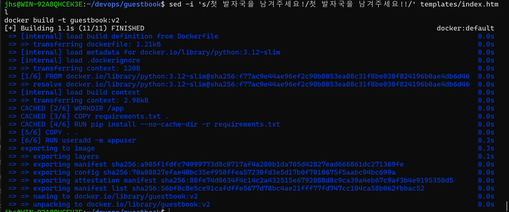
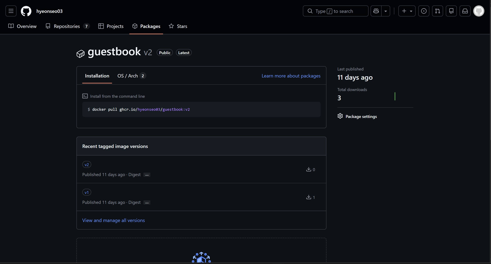
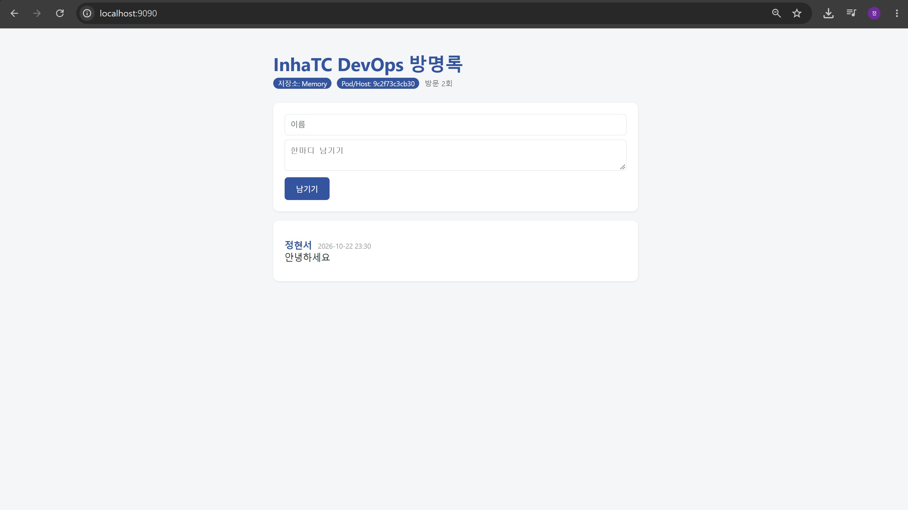
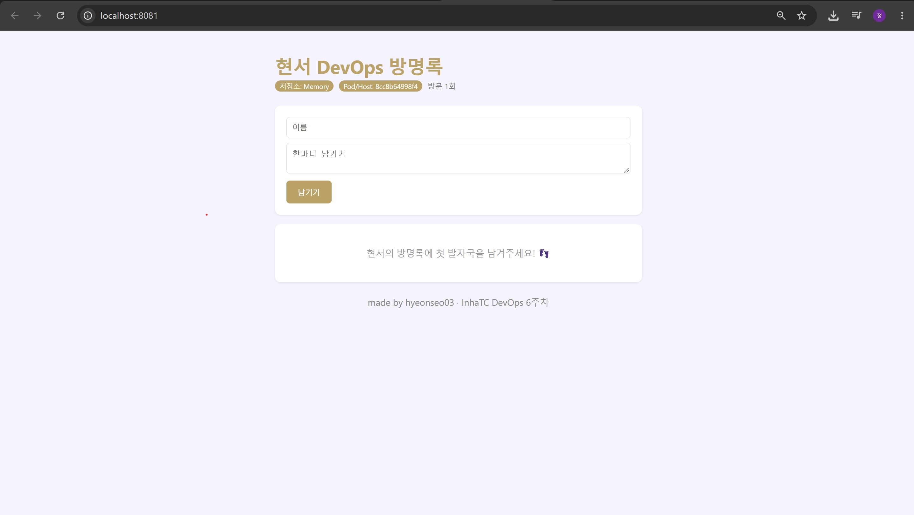

# 6주차 - Dockerfile과 이미지 배포

## 1. 실습 개요

지난주에는 남이 만든 이미지(nginx)를 실행만 했다면, 이번 주에는 Dockerfile을 이용해 방명록 앱을 직접 이미지로 만들었다.
제목, 색, 문구를 바꾼 `guestbook:v2`를 만들어서 ghcr.io에 올렸고, 친구 이미지도 받아서 실행해 봤다.

**내 이미지 주소**

```
ghcr.io/hyeonseo03/guestbook:v2
```

```bash
docker run -d -p 8080:5000 ghcr.io/hyeonseo03/guestbook:v2
```

## 2. 학습 내용

### 왜 Dockerfile이 필요한가

`python3 app.py`로 바로 실행하면 `ModuleNotFoundError: No module named 'flask'`가 난다.
`pip install flask`를 하면 되지만 친구 컴퓨터나 서버에서도 매번 똑같이 설치해야 한다.
그래서 실행에 필요한 환경까지 통째로 포장하는 방법이 Dockerfile이다.

### Dockerfile 한 줄씩 읽기

```dockerfile
FROM python:3.12-slim                 # 파이썬 3.12가 들어 있는 가벼운 이미지에서 시작한다
WORKDIR /app                          # 컨테이너 안 작업 폴더를 /app으로 정한다
COPY requirements.txt .               # 라이브러리 목록만 먼저 복사한다
RUN pip install --no-cache-dir -r requirements.txt   # 이미지를 만들 때 Flask, redis를 설치한다
COPY . .                              # 나머지 코드를 전부 복사한다
RUN useradd -m appuser                # 일반 사용자를 만든다
USER appuser                          # root가 아닌 사용자로 실행해서 더 안전하게 한다
ENV APP_TITLE="현서 DevOps 방명록" \
    THEME_COLOR="#7C3AED"             # 제목과 색 기본값을 이미지에 넣는다
EXPOSE 5000                           # 5000번 포트를 쓴다고 표시만 한다 (실제로 열지는 않음)
CMD ["python", "app.py"]              # 컨테이너가 켜질 때 앱을 실행한다
```

헷갈렸던 부분은 `RUN`과 `CMD`이다.
`RUN`은 이미지를 **만들 때** 한 번 실행되고, `CMD`는 컨테이너를 **켤 때마다** 실행된다.

### 레이어와 캐시

Dockerfile의 명령 한 줄이 레이어 하나가 된다.
한 번 빌드한 레이어는 저장해 두었다가, 바뀐 게 없으면 다시 만들지 않고 그대로 쓴다(CACHED).
대신 어떤 줄이 바뀌면 그 아래 줄은 전부 다시 빌드된다.

그래서 잘 안 바뀌는 `requirements.txt`를 먼저 복사하고, 자주 바뀌는 코드(`COPY . .`)를 뒤에 둔다.
반대로 `Dockerfile.bad`처럼 `COPY . .`를 먼저 하면 코드 한 줄만 고쳐도 `pip install`이 매번 다시 실행된다.

### 설정을 넣는 세 가지 방법

| 방법 | 언제 정해지나 | 바꾸려면 |
|---|---|---|
| `app.py` 기본값 | 코드를 작성할 때 | 코드 수정 후 다시 빌드 |
| Dockerfile `ENV` | 이미지를 빌드할 때 | 다시 빌드 |
| `docker run -e` | 컨테이너를 실행할 때 | 컨테이너만 다시 실행 |

우선순위는 **app.py 기본값 < Dockerfile ENV < docker run -e** 이다.
`app.py`의 기본 제목은 "DevOps 방명록", 색은 빨간색인데 내 이미지에서는 ENV에 넣은 값이 나온다.

### 배포 흐름

```
build → tag → push → (다른 컴퓨터에서) pull → run
```

```bash
docker build -t guestbook:v2 .
gh auth token | docker login ghcr.io -u hyeonseo03 --password-stdin
docker tag guestbook:v2 ghcr.io/hyeonseo03/guestbook:v2
docker push ghcr.io/hyeonseo03/guestbook:v2
```

이미지 이름은 `레지스트리/계정/이미지:태그` 형식이고, 계정 이름은 소문자로 써야 한다.

## 3. 실습 결과

### 나만의 방명록 v2

교안에서는 최소 3곳을 바꾸라고 해서 다음과 같이 수정했다.

- Dockerfile `ENV` : 제목을 `현서 DevOps 방명록`, 테마 색을 보라색 `#7C3AED`로 변경
- `index.html` : 글이 없을 때 문구를 `현서의 방명록에 첫 발자국을 남겨주세요! 👣`로 변경
- `index.html` : 배경색을 연보라(`#F5F3FF`)로 바꾸고 아래에 footer 추가


### 빌드 캐시 확인

`index.html` 문구만 바꾸고 다시 빌드하니 `pip install`까지는 CACHED로 넘어가고 `COPY . .`부터 다시 빌드됐다.

```text
=> CACHED [2/6] WORKDIR /app
=> CACHED [3/6] COPY requirements.txt .
=> CACHED [4/6] RUN pip install --no-cache-dir -r requirements.txt
=> [5/6] COPY . .
=> [6/6] RUN useradd -m appuser
```



### ghcr.io에 올리기

push 후 GitHub 프로필의 Packages에서 `guestbook`을 확인했다.
친구가 받을 수 있도록 Package settings에서 공개(Public)로 바꿨다.



### 친구 이미지 실행

친구의 이미지를 받아서 9090 포트로 실행했다.
내 컴퓨터에는 친구의 소스 코드도 없고 Flask도 설치하지 않았는데 그대로 실행됐다.

```bash
docker run -d -p 9090:5000 --name friend ghcr.io/<친구아이디>/guestbook:v2
```



여기에 남긴 글은 친구 컴퓨터에서는 보이지 않는다.
이미지는 프로그램을 공유하는 것이지 데이터까지 공유하는 것은 아니기 때문이다.

### -e로 색만 바꿔 보기

내 이미지에 `-e THEME_COLOR="#C6A15B"`를 주고 실행했다.

```bash
docker run -d -p 8081:5000 --name gbv2 -e THEME_COLOR="#C6A15B" ghcr.io/hyeonseo03/guestbook:v2
```

| 이미지에 구운 색 (ENV) | 실행할 때 주입한 색 (-e) |
|---|---|
|  |  |

제목은 ENV 값 그대로인데 색만 금색으로 바뀌었다.
실행할 때 넣은 `-e`가 이미지 안의 ENV보다 우선한다는 것을 확인했다.

## 4. 생각해보기

방명록에 글을 남기고 컨테이너를 재시작하면 색은 그대로인데 글은 사라진다.
글이 앱 프로세스의 메모리에만 저장되어 있어서, 재시작하면 프로세스가 새로 뜨면서 데이터도 없어지기 때문이다.
글을 남기려면 컨테이너 밖(파일이나 DB)에 저장해야 하는데, 이건 7주차에 Redis로 해결했다.

## 5. 파일 구성

```
devops/
├── guestbook/
│   ├── Dockerfile              # ENV 제목, 색 수정
│   ├── Dockerfile.bad          # 캐시 비교용 (COPY . . 를 먼저 한 나쁜 예)
│   ├── Dockerfile.multistage   # 이미지 줄이기 참고
│   ├── templates/index.html    # 문구, 배경색, footer 수정
│   └── app.py, requirements.txt
└── week06/
    ├── README.md
    └── images/
```

## 6. 느낀 점

"내 컴퓨터에서는 되는데요?"라는 말이 왜 나오는지, 이미지가 그 문제를 어떻게 줄이는지 직접 해보면서 이해했다.
Dockerfile 순서 하나로 빌드 시간이 크게 달라지는 것도 신기했다.
