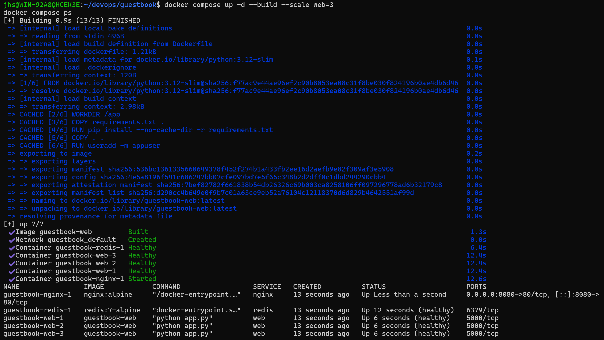
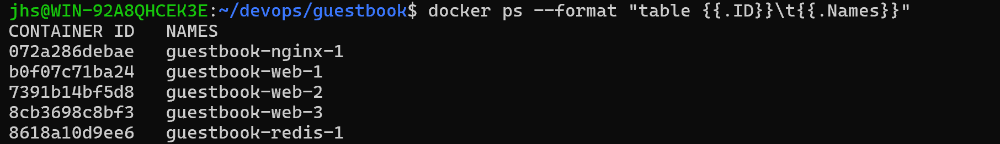
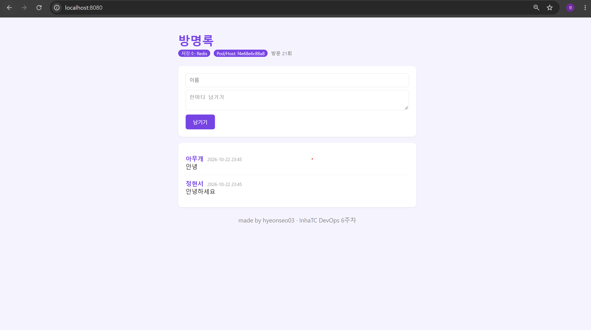
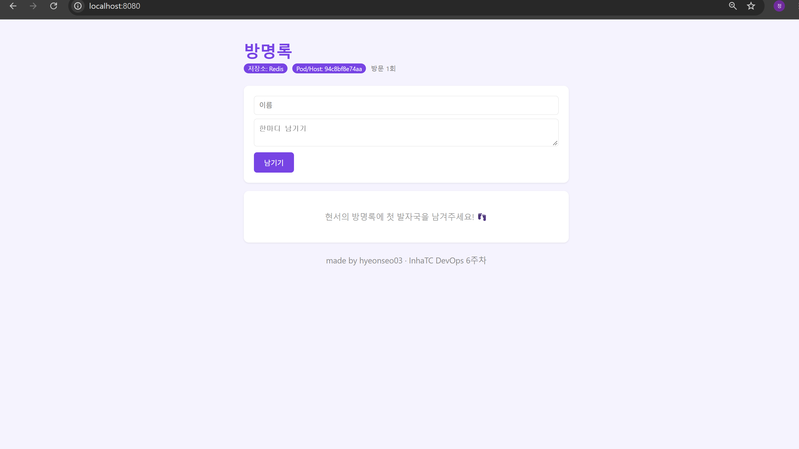

# 7주차 - Docker Compose

## 1. 실습 개요

6주차 방명록은 컨테이너를 재시작하면 글이 사라졌다.
이번 주에는 앱(web)과 데이터 저장소(redis)를 다른 컨테이너로 나누고, `compose.yaml` 하나로 같이 실행해서 이 문제를 해결했다.
이어서 비밀번호를 `.env`로 분리하고, healthcheck를 추가하고, nginx를 앞에 두어 web을 3개로 늘려 봤다.

```
브라우저 :8080
      │
   [nginx]            ← 밖에서 들어오는 문은 여기 하나 (8080:80)
      │  요청을 나눠서 전달
[web] [web] [web]     ← --scale web=3, 안에서만 5000 사용
      │
   [redis]            ← 데이터는 볼륨 redis-data에 저장
```

## 2. 학습 내용

### 컨테이너 하나에 역할 하나

앱과 DB를 한 컨테이너에 넣으면 앱만 업데이트하고 싶어도 DB까지 재시작해야 한다.
또 앱만 4개로 늘리고 DB는 1개로 두는 것처럼 따로 확장하기도 어렵다.
그래서 컨테이너 하나에는 역할 하나만 주는 것이 좋다.

### docker compose

여러 컨테이너를 `docker run`으로 하나씩 띄우면 명령이 길고, 오타가 나기 쉽고, 팀원에게 공유하기도 어렵다.
compose는 원하는 구성을 `compose.yaml`에 적어 두고 실행과 관리를 맡기는 방식이다.
`docker run`의 옵션이 거의 그대로 yaml의 키로 옮겨진다.

| docker run | compose.yaml |
|---|---|
| `-p 8080:5000` | `ports:` |
| `-e KEY=value` | `environment:` |
| `-v data:/path` | `volumes:` |
| `-d` | `docker compose up -d` |

YAML은 들여쓰기가 중요해서 Tab 대신 스페이스만 써야 한다.
`nano -ET2 compose.yaml`로 열면 Tab을 눌러도 스페이스 2칸으로 들어간다.

### 서비스 이름이 곧 주소

`REDIS_HOST: "redis"`처럼 IP 대신 서비스 이름을 적었다.
compose가 만든 네트워크 안에서는 도커 내부 DNS가 `redis`라는 이름을 IP로 바꿔준다.
그래서 컨테이너가 새로 만들어져 IP가 바뀌어도 상관없다.
반대로 `ports:`가 없는 redis는 내 컴퓨터(호스트)에서 6379로 직접 접속할 수 없었다.

### 볼륨

컨테이너는 지우면 사라지지만, 볼륨은 컨테이너 밖에 따로 저장된다.
redis의 `/data`를 `redis-data` 볼륨에 연결해서 컨테이너를 지워도 글이 남게 했다.

### .env로 비밀번호 분리

처음에는 `compose.yaml`에 비밀번호를 그대로 적었는데, 이렇게 하면 Git에 비밀번호가 올라간다.
그래서 `.env` 파일에 `REDIS_PASSWORD`를 적고, `compose.yaml`에는 `${REDIS_PASSWORD}`로 빈칸만 남겼다.
`.env`는 compose.yaml과 같은 폴더에 있으면 자동으로 읽힌다.

### healthcheck

`depends_on`만 쓰면 redis를 먼저 "시작"만 시켜줄 뿐 준비가 끝났는지는 기다리지 않는다.
교안의 식당 비유처럼 문을 열었다고 바로 주문을 받을 수 있는 건 아니다.
그래서 healthcheck를 추가하고 `condition: service_healthy`로 redis가 준비된 다음에 web이 시작되게 했다.

- redis : `redis-cli ping`에 응답하면 healthy
- web : `/readyz`가 정상 응답하면 healthy (Redis 연결이 안 되면 503)

### scale과 nginx

`--scale web=3`을 했더니 처음에는 `port is already allocated` 에러가 났다.
web 3개가 모두 8080을 쓰려고 했기 때문이다.
web의 `ports:`를 `expose: "5000"`으로 바꾸고, 앞에 nginx를 두어 8080으로 받은 요청을 web들에게 나눠주게 했다.

```nginx
server {
    listen 80;
    resolver 127.0.0.11 valid=5s;   # 도커 내부 DNS

    location / {
        set $backend http://web:5000;
        proxy_pass $backend;        # 받은 요청을 web으로 전달
    }
}
```

`web`이라는 이름으로 물어보면 도커 DNS가 web 3개의 IP를 알려주고, nginx가 번갈아 요청을 보낸다.

## 3. 실습 결과

### 3-1. docker compose ps (healthy)

```bash
docker compose up -d --build --scale web=3
docker compose ps
```



nginx 1개, web 3개, redis 1개가 실행되었고 web과 redis가 `(healthy)`로 표시됐다.
밖으로 열린 포트는 nginx의 8080 하나뿐이다.

### 3-2. scale 후 바뀌는 호스트명

```bash
docker ps --format "table {{.ID}}\t{{.Names}}"
```



| 새로고침 1 | 새로고침 2 |
|---|---|
|  |  |

새로고침할 때마다 Pod/Host 값이 바뀌었고, 그 값이 `docker ps`의 web 컨테이너 ID와 같았다.
nginx가 요청을 web 3개에 나눠 보내기 때문이다.
어느 web이 응답해도 글 목록은 똑같았는데, 데이터가 redis 하나에 저장되어 있기 때문이다.

### 3-3. down 후 up vs down -v 후 up

| `down` → `up` | `down -v` → `up` |
|---|---|
|  |  |
| 글이 그대로 남아 있음 | 글이 전부 사라짐 |

- `down`은 컨테이너와 네트워크만 지우고 볼륨(`redis-data`)은 남긴다. 그래서 다시 `up` 하면 글이 그대로 있다.
- `down -v`는 볼륨까지 지운다. `docker volume ls`에서도 볼륨이 사라진 것을 확인했다.

실제 서비스에서 `-v`를 잘못 쓰면 데이터가 전부 날아갈 수 있어서 조심해야 할 것 같다.

### 3-4. .env를 Git에 올리지 않는 이유

`.env`에는 `REDIS_PASSWORD` 같은 비밀번호가 들어 있다.
GitHub에 올리면 누구나 볼 수 있고, 나중에 지워도 커밋 기록에 남아 있어서 완전히 지우기 어렵다.

그래서 다음과 같이 처리했다.

- `.gitignore`에 `.env`를 추가해서 Git이 추적하지 않게 했다.
- `.dockerignore`에도 `.env`가 있어서 `COPY . .`를 해도 이미지 안에 들어가지 않는다.
- 어떤 값이 필요한지는 `.env.example`에 이름만 적어서 올렸다.
- `compose.yaml`에는 `${REDIS_PASSWORD:?비밀번호 설정 필요}`로 적어서 값이 없으면 실행 전에 에러가 나게 했다.

## 4. 파일 구성

```
devops/
├── .gitignore              # .env 추가
├── guestbook/
│   ├── compose.yaml        # nginx + web + redis, healthcheck, watch
│   ├── nginx.conf          # 요청을 web:5000으로 전달
│   ├── .env.example        # .env 양식 (실제 .env는 올리지 않음)
│   └── app.py, Dockerfile  # 6주차 그대로
└── week07/
    ├── README.md
    └── images/
```

## 5. 느낀 점

명령어 한 줄로 네트워크, 볼륨, 컨테이너 5개가 한꺼번에 뜨는 게 편했다.
새로고침할 때마다 다른 컨테이너가 응답하는 걸 직접 보니 로드 밸런싱이 무슨 뜻인지 이해가 됐다.
다만 compose는 컴퓨터 한 대 안에서만 동작해서, 서버가 여러 대일 때는 다른 도구가 필요하다는 것도 알게 됐다.
