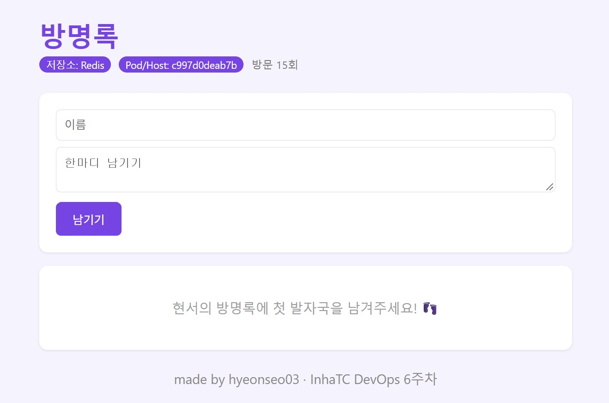

# 7주차 - 도커 컴포즈

## 1. docker compose ps 결과

```
NAME                IMAGE            COMMAND                  SERVICE   CREATED          STATUS                    PORTS
guestbook-nginx-1   nginx:alpine     "/docker-entrypoint.…"   nginx     28 minutes ago   Up 28 minutes             0.0.0.0:8080->80/tcp, [::]:8080->80/tcp
guestbook-redis-1   redis:7-alpine   "docker-entrypoint.s…"   redis     42 minutes ago   Up 42 minutes (healthy)   6379/tcp
guestbook-web-1     guestbook-web    "python app.py"          web       28 minutes ago   Up 28 minutes (healthy)   5000/tcp
guestbook-web-2     guestbook-web    "python app.py"          web       28 minutes ago   Up 28 minutes (healthy)   5000/tcp
guestbook-web-3     guestbook-web    "python app.py"          web       28 minutes ago   Up 28 minutes (healthy)   5000/tcp
```

redis와 web 둘 다 healthy로 나오는 것을 확인했다.
redis는 ping에 응답하면 healthy, web은 /readyz가 정상 응답하면 healthy가 된다.

## 2. scale 후 호스트명 바뀌는 화면

`docker compose up -d --scale web=3` 으로 web을 3개 띄웠다.




새로고침할 때마다 Pod/Host 값이 바뀌었고, docker ps로 본 컨테이너 ID와 같았다.
nginx가 요청을 web 3개에 나눠서 보내기 때문이다.
글은 어느 web으로 가도 똑같이 보였는데, 데이터는 redis 하나에 저장되어 있기 때문이다.

## 3. down 후 up vs down -v 후 up

- `docker compose down` 후 `up -d` : 글이 그대로 남아 있었다.
  down은 컨테이너와 네트워크만 지우고 볼륨(redis-data)은 남기기 때문이다.
- `docker compose down -v` 후 `up -d` : 글이 전부 사라졌다.
  -v를 붙이면 볼륨까지 지워져서 redis 데이터도 같이 없어진다.

실제 서비스에서 -v를 잘못 쓰면 데이터가 날아갈 수 있어서 조심해야 할 것 같다.

## 4. .env를 Git에 올리지 않는 이유

.env에는 REDIS_PASSWORD 같은 비밀번호가 들어 있다.
이걸 GitHub에 올리면 누구나 비밀번호를 볼 수 있고, 나중에 지워도 Git 기록에 남을 수 있다.
그래서 .gitignore에 .env를 넣어서 올라가지 않게 했고,
어떤 값이 필요한지는 .env.example에 이름만 적어서 올렸다.
compose.yaml에는 비밀번호 대신 ${REDIS_PASSWORD}로 적어서 실행할 때 .env 값이 들어가게 했다.
