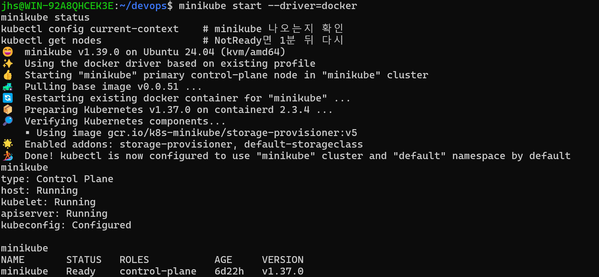
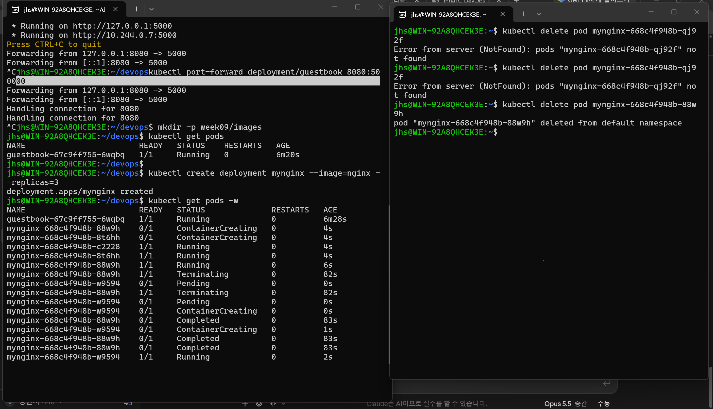
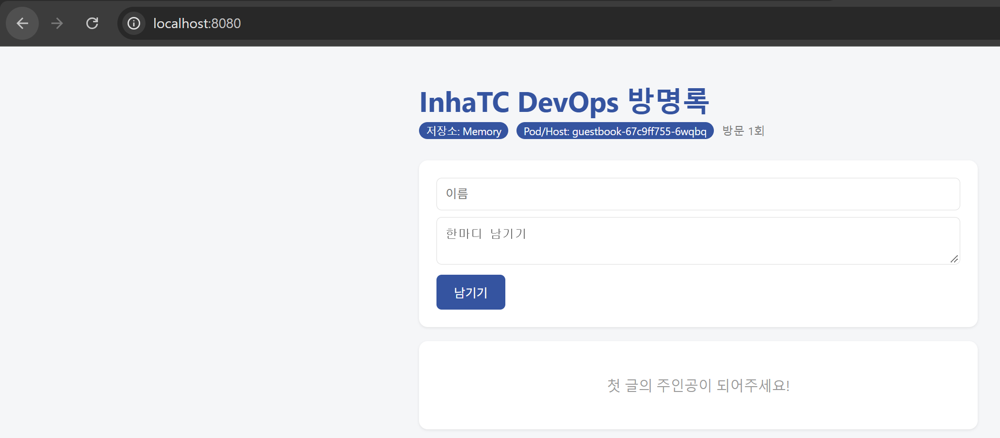

# Week 09 - 쿠버네티스 첫 배포

이번 주는 minikube로 내 노트북 안에 쿠버네티스 클러스터를 만들고, 6주차에 GHCR에 올렸던 방명록 이미지를 쿠버네티스 위에서 띄워봤다.

- 환경: WSL(Ubuntu), Docker Desktop
- 사용한 도구: **minikube** (`--driver=docker`)
- 이미지: `ghcr.io/hyeonseo03/guestbook:v1`

<br>

## 1. 클러스터 실행 확인

```bash
minikube start --driver=docker
kubectl config current-context
kubectl get nodes
```

`minikube` 노드가 **Ready** 상태로 나왔다. (v1.37.0)
kubectl은 리모컨이고 minikube가 실제 클러스터라서 둘 다 있어야 동작한다는 게 이해됐다.



<br>

## 2. 자가 치유 확인

처음에 `kubectl run`으로 만든 Pod는 지우니까 그냥 없어졌다.
그래서 Deployment로 3개를 만들어 놓고, 다른 터미널에서 `get pods -w`로 지켜보면서 하나를 지워봤다.

```bash
kubectl create deployment mynginx --image=nginx --replicas=3
kubectl get pods -w                         # 터미널 2
kubectl delete pod mynginx-668c4f948b-88w9h  # 터미널 1
```

`88w9h`가 Terminating 되자마자 `w9594`라는 새 Pod가 Pending → ContainerCreating → Running 으로 바로 올라왔다.
나는 지우기만 했고 다시 만들라는 명령은 안 했는데 쿠버네티스가 "3개여야 하는데 2개네?" 하고 알아서 채운 것이다.



새로 생긴 Pod는 이름 끝이 달라서, 원래 Pod를 살린 게 아니라 **새로 만든 것**이라는 걸 알 수 있었다.
그래서 Pod 안에 저장한 데이터는 같이 날아간다.

<br>

## 3. 내 방명록 쿠버네티스에서 띄우기

```bash
kubectl create deployment guestbook --image=ghcr.io/hyeonseo03/guestbook:v1
kubectl get pods
kubectl port-forward deployment/guestbook 8080:5000
```

브라우저에서 `localhost:8080`으로 접속하니 방명록이 떴다.
배지에 나온 `Pod/Host: guestbook-67c9ff755-6wqbq`가 `kubectl get pods`에 나온 Pod 이름이랑 똑같았다.
저장소는 Redis 없이 실행해서 Memory로 나온다.



<br>

## 선언형을 내 말로 정리하면

> 하나하나 "이렇게 해"라고 시키는 게 아니라 "이 상태였으면 좋겠어"라고 정해두면 알아서 맞춰주는 것.
> 보일러 온도를 23도로 맞춰 두면 내가 껐다 켰다 안 해도 알아서 유지되는 것과 비슷하다.

<br>

## 막혔던 것

**1. localhost:8080 접속이 거부됨**
명령어를 여러 줄 한꺼번에 붙여넣다가 port-forward를 Ctrl+C로 꺼버려서 연결 통로가 없어진 상태였다.
port-forward 한 줄만 다시 실행하고 터미널을 그대로 둔 채 접속하니 해결됐다.

**2. `Error from server (NotFound)`**
Deployment를 지웠다가 다시 만들었더니 Pod 이름이 바뀌어 있었는데, 예전 이름으로 지우려고 해서 났다.
`kubectl get pods`로 지금 이름을 다시 확인하고 지우니 됐다.

**3. GitHub에 `Zone.Identifier` 파일이 같이 올라감**
윈도우 탐색기로 파일을 WSL 폴더에 복사하면 생기는 파일이었다. 삭제하고 `.gitignore`에 추가했다.

<br>

## 느낀 점

명령어 자체는 docker랑 비슷해서(`logs`, `exec`, `describe`) 생각보다 어렵지 않았다.
그런데 Pod를 지우면 Pod는 다시 생기지만 port-forward 연결은 끊어져서 다시 켜야 했다.
매번 이러면 불편할 것 같은데 다음 주에 배우는 Service가 이걸 해결해 준다고 해서 궁금하다.
