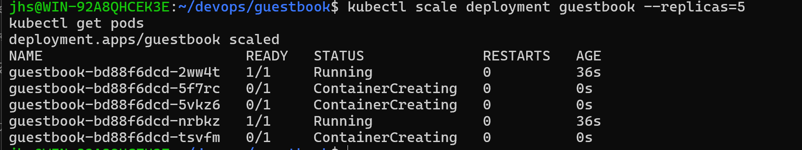
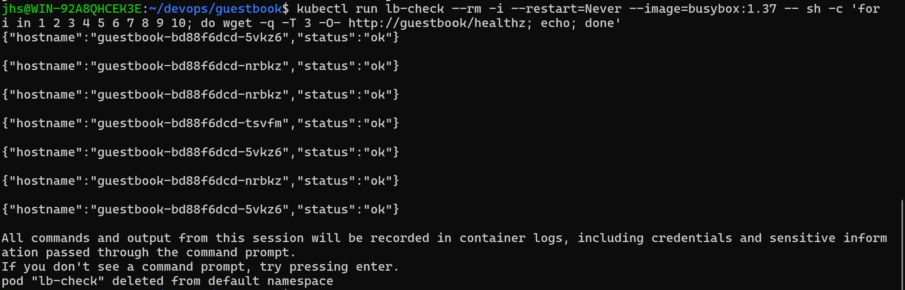
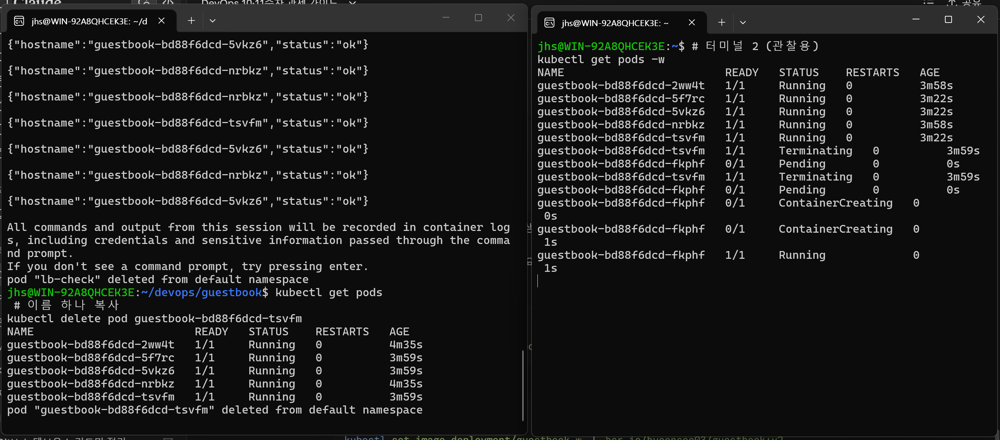
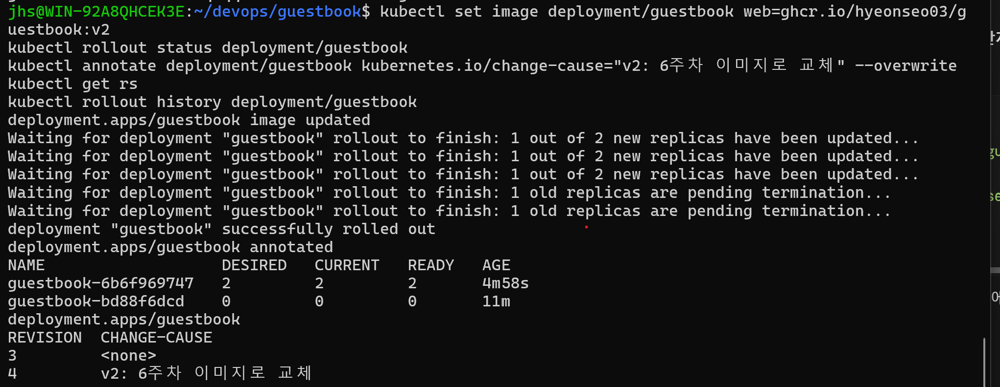
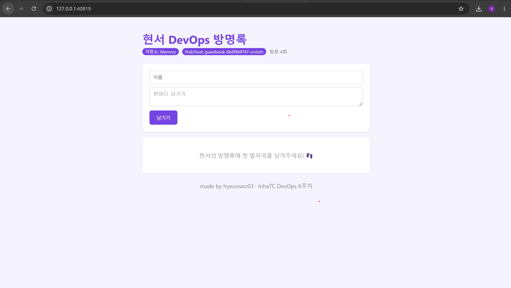
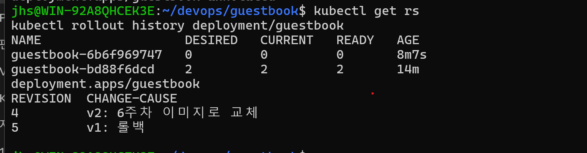

# Week 10 - 쿠버네티스 Deployment와 Service

지난주에는 `kubectl create`로 명령을 쳐서 Pod를 만들었는데, 이번 주는 원하는 상태를 YAML 파일에 적어두고 `kubectl apply`로 맞추는 방식(선언형)으로 바꿨다.
Service를 붙여서 Pod가 여러 개여도 주소 하나로 접속하게 만들고, 스케일링 → 롤링 업데이트(v1 → v2) → 롤백까지 해봤다.

- 환경: WSL(Ubuntu), Docker Desktop, minikube (`--driver=docker`)
- 이미지: `ghcr.io/hyeonseo03/guestbook:v1` (9주차), `ghcr.io/hyeonseo03/guestbook:v2` (6주차에 만든 것)

<br>

## 0. 9주차에 만든 것 정리

9주차에 `kubectl create`로 만든 guestbook은 컨테이너 이름이 `web`이 아니라서, 그대로 두고 apply하면 꼬일 것 같아 먼저 지웠다.

```bash
kubectl delete deployment guestbook mynginx --ignore-not-found
```

<br>

## 1. YAML 파일 두 개 작성

`guestbook/k8s/` 폴더를 만들고 매니페스트 두 개를 작성했다.

```
guestbook/k8s/
├── deployment.yaml   # replicas 2, image v1, 레이블 app=guestbook, 컨테이너 이름 web
└── service.yaml      # NodePort 30080 → 80 → 5000
```

```bash
kubectl apply -f k8s/deployment.yaml --dry-run=server   # 문법 검사만
kubectl apply -f k8s/
kubectl get all
```

`app: guestbook` 레이블을 Deployment의 `matchLabels`, `template.labels`, Service의 `selector` 세 곳에 똑같이 써야 연결된다.
Service의 selector에는 `matchLabels:`가 없다는 게 Deployment랑 달라서 헷갈렸다.

<br>

## 2. replicas 5로 늘리기

```bash
kubectl scale deployment guestbook --replicas=5
kubectl get pods
```

명령 한 줄에 Pod가 5개로 늘었다. 이름 가운데 `bd88f6dcd`는 5개 모두 같고 끝 5글자만 다르다. 같은 틀(ReplicaSet)에서 찍어낸 Pod라는 뜻이다.



<br>

## 3. 서비스를 통과한 요청 → 서로 다른 Pod

클러스터 안에 busybox Pod를 잠깐 띄워서 `http://guestbook/healthz`로 10번 요청을 보냈다.

```bash
kubectl run lb-check --rm -i --restart=Never --image=busybox:1.37 -- \
  sh -c 'for i in 1 2 3 4 5 6 7 8 9 10; do wget -q -T 3 -O- http://guestbook/healthz; echo; done'
```

같은 주소로 보냈는데 응답한 hostname이 `5vkz6`, `nrbkz`, `tsvfm` 등으로 계속 바뀌었다.
로드밸런서를 따로 설정한 적이 없는데 Service가 레이블로 찾은 Pod들한테 알아서 나눠 보낸 것이다.
7주차에는 nginx를 직접 붙이고 nginx.conf까지 썼던 걸 생각하면 훨씬 편하다.



<br>

## 4. Pod 하나 강제 삭제

터미널 2개를 열어서 한쪽은 `get pods -w`로 지켜보고, 다른 쪽에서 `tsvfm`을 지웠다.

```bash
kubectl get pods -w                              # 터미널 2
kubectl delete pod guestbook-bd88f6dcd-tsvfm     # 터미널 1
```

`tsvfm`이 Terminating 되자마자 `fkphf`가 Pending → ContainerCreating → Running 으로 1초 만에 올라왔다.
새 Pod도 가운데가 `bd88f6dcd`라서, 같은 틀로 다시 구운 거라는 걸 알 수 있었다.



<br>

## 5. 롤링 업데이트 v1 → v2

다시 2개로 줄이고 이미지를 v2로 바꿨다.
v2는 6주차에 제목이랑 색을 바꿔서 GHCR에 올려둔 이미지라서 새로 빌드할 필요가 없었다.

```bash
kubectl scale deployment guestbook --replicas=2
kubectl set image deployment/guestbook web=ghcr.io/hyeonseo03/guestbook:v2
kubectl rollout status deployment/guestbook
kubectl annotate deployment/guestbook kubernetes.io/change-cause="v2: 6주차 이미지로 교체" --overwrite
kubectl get rs
kubectl rollout history deployment/guestbook
```

`rollout status`에 `1 out of 2 new replicas have been updated` → `1 old replicas are pending termination` → `successfully rolled out` 순서로 나왔다.
한 번에 다 바꾸는 게 아니라 새 Pod 하나 띄우고, 옛 Pod 하나 내리고를 반복한다.

`get rs`를 보면 새 틀 `6b6f969747`이 `2 2 2`, 옛 틀 `bd88f6dcd`는 `0 0 0`이다. 옛 틀은 지워지지 않고 0개로 남아 있다.



브라우저에서 확인하니 6주차에 만든 "현서 DevOps 방명록" 화면이 나왔고, Pod/Host가 `guestbook-6b6f969747-cmbxh`로 새 틀 이름이었다.
하단에 "InhaTC DevOps 6주차"가 그대로 있는 건 v2가 6주차에 만든 이미지라서 그렇다.
저장소는 아직 Redis가 없어서 Memory다.



<br>

## 6. 롤백

```bash
kubectl rollout undo deployment/guestbook
kubectl rollout status deployment/guestbook
kubectl annotate deployment/guestbook kubernetes.io/change-cause="v1: 롤백" --overwrite
kubectl get rs
kubectl rollout history deployment/guestbook
```

코드를 고치거나 다시 빌드하지 않았는데, 0개로 남겨뒀던 `bd88f6dcd`가 다시 `2 2 2`가 되면서 v1으로 돌아왔다.
history는 번호가 지워지는 게 아니라 `4 v2`, `5 v1: 롤백`처럼 새 번호로 쌓였다. git revert랑 비슷하다.



<br>

## 내 말로 정리하면

- **Deployment / ReplicaSet / Pod**: 나는 Deployment만 만들고, ReplicaSet이 개수를 맞추고, Pod가 실제로 일한다. Pod 이름 = Deployment 이름 + 틀 번호 + 랜덤 5글자.
- **Service**: Pod는 죽었다 살아나면 IP가 바뀌니까 앞에 고정된 대표번호를 두는 것. 레이블만 맞으면 새 Pod도 알아서 명단에 들어간다.
- **롤링 업데이트**: 틀(template)이 바뀌면 새 ReplicaSet을 만들고 하나씩 갈아끼운다. 그래서 서비스가 멈추지 않는다.
- **롤백**: 옛 틀을 0개로 보관하고 있다가 다시 늘리는 것이라 빠르다.

<br>

## 왜 굳이? (10주차 "왜 굳이" 수업)

- **상황 A** (혼자 만드는 방명록, 서버 한 대): 쿠버네티스까지는 필요 없을 것 같다. 도커 컴포즈로 web + redis를 띄우면 충분하다.
- **상황 B** (방문자가 늘어서 여러 서버로 운영): 서버마다 손으로 띄우고 죽으면 다시 켜는 게 힘들기 때문에, 개수를 유지해주고 롤링 업데이트가 되는 쿠버네티스가 맞다.

도구를 먼저 고르는 게 아니라 "지금 무슨 문제가 있지?"를 먼저 생각해야 한다는 게 기억에 남았다.

<br>

## 막혔던 것

**1. history 캡처를 못 찍어서 롤링 업데이트를 다시 함**
처음에 set image랑 undo를 했는데 캡처를 놓쳐서 다시 했다.
그래서 history 번호가 1, 2가 아니라 3, 4, 5로 나온다. 같은 v2로 다시 바꾸니까 새 틀을 만들지 않고 예전에 만든 `6b6f969747`을 다시 썼다(AGE가 이미 몇 분 지나 있었다).

**2. `fatal: pathspec 'guestbook' did not match any files`**
`~/devops/guestbook` 안에서 `git add guestbook week10`을 쳐서 경로를 못 찾았다. 커밋은 안 됐는데 `git tag week10`은 실행돼서 9주차 커밋에 태그가 붙어 올라갔다.
`git tag -d week10`, `git push origin --delete week10`으로 태그를 지우고 `~/devops`에서 다시 커밋했다. 명령 치기 전에 프롬프트 위치를 확인해야겠다.

<br>

## 느낀 점

지난주에는 Pod를 지우면 port-forward가 끊겨서 불편했는데, Service를 쓰니까 Pod가 바뀌어도 주소는 그대로라서 그 문제가 해결됐다.
다만 저장소가 Memory라서 새로고침할 때마다 Pod가 바뀌면 글이랑 방문 수가 Pod마다 따로 논다. 다음 주에 Redis를 붙이면 이게 해결된다고 해서 기대된다.
