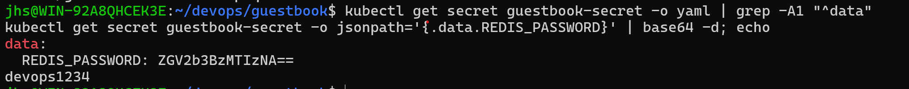
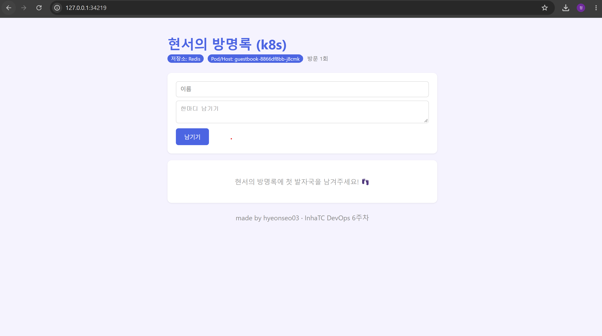
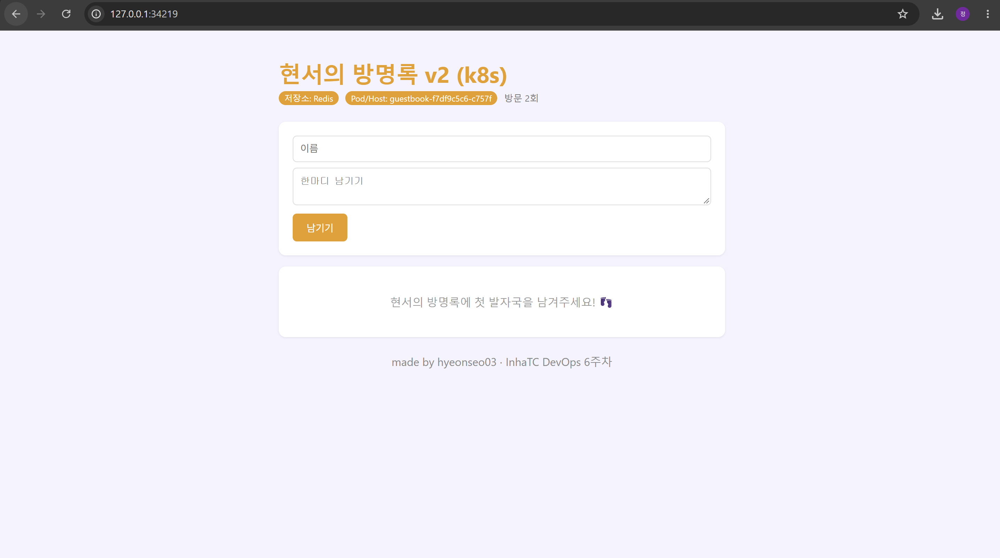
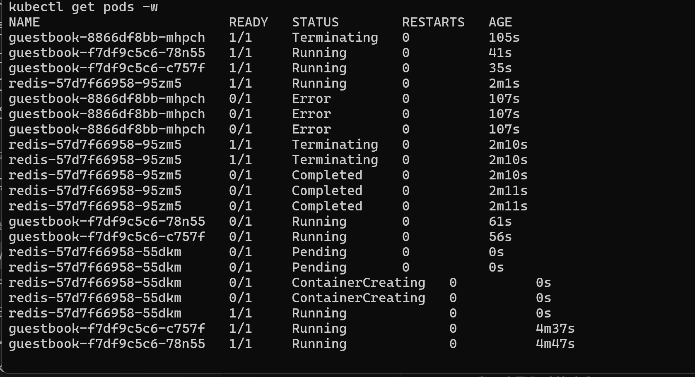
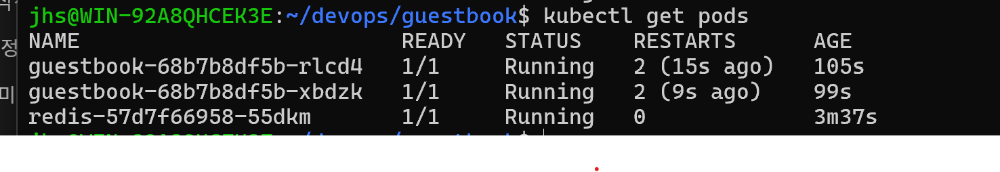
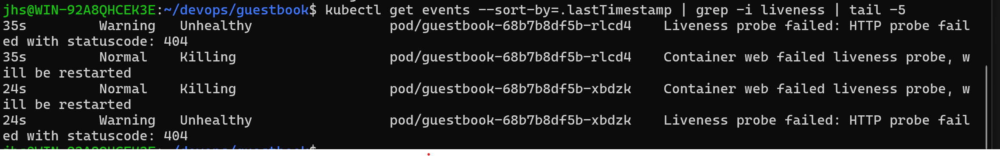

# Week 11 - 쿠버네티스 설정과 상태 점검

이번 주는 이미지는 그대로 두고 설정만 바깥으로 빼는 걸 해봤다.
ConfigMap/Secret을 만들어서 방명록에 환경 변수로 넣고, Redis를 쿠버네티스에 같이 띄워서 연결했다.
그다음 readiness / liveness 프로브를 걸고 일부러 실패시켜서 어떻게 반응하는지 봤다.

- 환경: WSL(Ubuntu), Docker Desktop, minikube (`--driver=docker`)
- 이미지: `ghcr.io/hyeonseo03/guestbook:v2`, `redis:7-alpine`

<br>

## 파일 구성

```
guestbook/k8s/
├── deployment.yaml       # envFrom(ConfigMap+Secret), resources, liveness/readiness 추가
├── service.yaml          # 10주차 그대로 (NodePort 30080)
├── configmap.yaml        # APP_TITLE, THEME_COLOR, REDIS_HOST, REDIS_PORT
├── redis.yaml            # Redis Deployment + ClusterIP Service (--- 로 구분)
├── secret.yaml           # 진짜 비밀번호 → .gitignore 처리, GitHub에 안 올라감
└── secret.yaml.example   # 비밀번호를 CHANGE_ME로 바꾼 예시만 올림
```

<br>

## 1. Secret 까보기

```bash
kubectl apply -f k8s/configmap.yaml -f k8s/secret.yaml
kubectl get secret guestbook-secret -o yaml | grep -A1 "^data"
kubectl get secret guestbook-secret -o jsonpath='{.data.REDIS_PASSWORD}' | base64 -d; echo
```

`-o yaml`로 보면 `ZGV2b3BzMTIzNA==`로 나와서 뭔가 잠겨 있는 것처럼 보이는데, `base64 -d` 한 번 하니까 `devops1234`가 그대로 나왔다.



**왜 안전하지 않은가?**
Secret은 이름만 비밀이지 암호화가 아니라 base64로 **표기 방식만 바꾼 것(인코딩)**이다. 열쇠가 필요 없어서 kubectl 권한만 있으면 누구나 원래 값을 볼 수 있다.
그래서 `secret.yaml`은 `.gitignore`에 넣고, GitHub에는 비밀번호를 `CHANGE_ME`로 바꾼 `secret.yaml.example`만 올렸다.
`git status`에 `secret.yaml`이 안 뜨고 example만 뜨는 것도 확인했다.

| | 하는 일 | 되돌리기 |
|---|---|---|
| 인코딩 (base64) | 표기만 바꿈 | 누구나 가능 |
| 암호화 | 열쇠로 잠금 | 열쇠 있어야 가능 |
| 해시 | 지문 만들기 | 불가능 (비교만) |

<br>

## 2. Redis 연결

`redis.yaml`에 Deployment랑 Service를 `---`로 나눠서 같이 넣었다.
Redis 비밀번호는 `env.valueFrom.secretKeyRef`로 Secret에서 하나만 골라 넣고, 방명록은 `envFrom`으로 ConfigMap이랑 Secret을 통째로 넣었다.

```bash
kubectl apply -f k8s/redis.yaml
kubectl apply -f k8s/deployment.yaml
kubectl logs -l app=guestbook | grep Redis
# [INFO] Redis 연결 성공: redis:6379
```

`minikube service guestbook`으로 들어가 보니 배지가 **저장소: Redis**로 바뀌어 있었다.
제목은 ConfigMap에 넣은 "현서의 방명록 (k8s)", 색은 파란색(`#2563eb`)이다.
이미지는 6주차 v2 그대로인데(하단 "6주차" 문구) 제목이랑 색은 ConfigMap 값으로 덮어써졌다.

- Pod/Host: `guestbook-8866df8bb-j8cmk`
- 방문 1회



<br>

## 3. ConfigMap만 바꿔서 제목/색 변경

이미지 다시 빌드 안 하고 `configmap.yaml`만 고쳐서 apply 했다.
`kubectl edit`으로 바꾸면 파일에는 안 남아서 파일을 고치는 방식으로 했다.

```bash
sed -i 's/현서의 방명록 (k8s)/현서의 방명록 v2 (k8s)/; s/#2563eb/#f59e0b/' k8s/configmap.yaml
kubectl apply -f k8s/configmap.yaml
kubectl rollout restart deployment guestbook
kubectl rollout status deployment guestbook
```

새로고침하니까 제목이 "현서의 방명록 **v2** (k8s)"로 바뀌고 제목, 배지, 버튼 색이 전부 파란색 → 주황색(`#f59e0b`)으로 바뀌었다.

- Pod/Host: `guestbook-8866df8bb-j8cmk` → `guestbook-f7df9c5c6-c757f` (rollout restart로 새 틀의 Pod로 교체됨)
- 방문 1회 → **2회**

여기서 신기했던 건 방문 수다. Pod가 아예 새 걸로 바뀌었는데 방문 수가 1부터 다시 시작하지 않고 2로 이어졌다.
10주차에는 Memory 모드라 Pod마다 방문 수가 따로 놀았는데, 이제는 숫자를 Pod 안이 아니라 Redis에 저장하니까 Pod가 바뀌어도 이어진다(무상태 앱 + 공유 DB).



- 이미지 다시 빌드했나? → 아니
- 코드 고쳤나? → 아니
- 데이터(방문 수)가 날아갔나? → 아니

`rollout restart`가 필요한 이유는 환경 변수는 프로세스가 **시작할 때** 한 번 읽어서, ConfigMap을 바꿔도 이미 떠 있는 Pod는 옛날 값을 계속 쓰기 때문이다.

<br>

## 4. readiness 실패 (READY 0/1)

터미널 2에서 `get pods -w`로 지켜보면서, 터미널 1에서 Redis를 0개로 줄였다.

```bash
kubectl scale deployment redis --replicas=0
```

`redis-...-95zm5`가 Terminating → Completed로 꺼지고 나서, guestbook 두 개(`78n55`, `c757f`)가 **STATUS는 Running인데 READY가 0/1**로 바뀌었다.
앱은 살아 있는데 Redis가 없으니 `/readyz`가 503을 줘서, 쿠버네티스가 "손님 받을 준비 안 됨"으로 보고 서비스 명단에서 뺀 것이다. RESTARTS는 0 그대로라서 재시작은 안 한다.

다시 Redis를 1개로 늘리니까 새 Pod `55dkm`이 뜨고, 내가 guestbook에 아무것도 안 했는데 두 개 다 알아서 1/1로 돌아왔다.

```bash
kubectl scale deployment redis --replicas=1
```



위쪽에 `guestbook-8866df8bb-mhpch`가 Error로 몇 줄 나오는데, 이건 3번에서 rollout restart 할 때 교체된 옛 틀(`8866df8bb`)의 Pod가 정리되는 거라 이번 실험이랑은 상관없다.

<br>

## 5. liveness 실패 (RESTARTS 증가)

일부러 없는 경로 `/devops`로 liveness를 검사하게 patch 했다.

```bash
kubectl patch deployment guestbook -p '{"spec":{"template":{"spec":{"containers":[{"name":"web","livenessProbe":{"httpGet":{"path":"/devops","port":5000},"periodSeconds":5,"failureThreshold":2}}]}}}}'
```

새 Pod(`rlcd4`, `xbdzk`)가 뜨고 1분 반쯤 지나니까 둘 다 **RESTARTS 2**가 됐다.
앱은 멀쩡한데 프로브가 없는 주소를 찔러서 404를 받으니까 죽었다고 판단하고 계속 재시작한다.



```bash
kubectl get events --sort-by=.lastTimestamp | grep -i liveness | tail -5
```

이벤트에 `Liveness probe failed: HTTP probe failed with statuscode: 404` → `Container web failed liveness probe, will be restarted` 순서로 원인과 결과가 같이 찍혀 있었다.



원래대로는 `kubectl apply -f k8s/deployment.yaml` 한 줄로 돌렸다. patch는 파일에 안 남으니까 파일 기준으로 다시 맞추면 된다.

**readiness vs liveness 비교**

| | 물어보는 것 | 실패하면 | 내 실험에서 보인 것 |
|---|---|---|---|
| readiness `/readyz` | 손님 받을 준비 됐니? | 트래픽만 끊음 (재시작 X) | READY 0/1, RESTARTS 0 |
| liveness `/healthz` | 살아 있니? | 컨테이너 재시작 | READY 1/1, RESTARTS 2 |

<br>

## 트러블슈팅 3단 루틴 (내 말로)

1. **`kubectl get pods`** - 일단 전체 상태부터 본다. STATUS, READY, RESTARTS 세 칸만 봐도 대충 어디가 문제인지 감이 온다. (READY 0/1이면 readiness, RESTARTS가 오르면 liveness나 앱 에러)
2. **`kubectl describe pod <이름>`** - 맨 아래 Events를 본다. 쿠버네티스가 "내가 왜 이렇게 했는지"를 적어두는 곳이라 이번에도 404가 여기 그대로 나왔다. 이미지 오타나 ConfigMap 이름 오타 같은 건 여기서 끝난다.
3. **`kubectl logs <이름>`** (계속 죽으면 `--previous`) - 컨테이너는 떴는데 앱 안에서 에러가 난 경우는 Events에는 "계속 죽는다"만 나오고 진짜 이유는 앱 로그에 있다.

병원으로 치면 get은 "어디 아파요?", describe는 진료 기록, logs는 정밀 검사 같다.
AI한테 물어보더라도 이 세 개 결과를 먼저 모아야 뭘 붙여넣을지 알 수 있고, 붙여넣기 전에 비밀번호 같은 값은 지워야 한다.

<br>

## 막혔던 것

**1. patch 했더니 `patched (no change)`**
에러인 줄 알았는데 앞에서 이미 한 번 실행돼서 같은 내용이라 바뀐 게 없다는 뜻이었다.
`kubectl get deployment guestbook -o jsonpath='{...livenessProbe.httpGet.path}'`로 `/devops`가 들어가 있는 걸 확인하고 기다리니 RESTARTS가 올라갔다.

**2. `get pods -w`가 안 끝나서 멈춘 줄 알았음**
`-w`는 변화가 생길 때마다 한 줄씩 추가하려고 계속 기다리는 명령이라 원래 안 끝난다. Ctrl+C로 끄면 된다.

**3. 옛 Pod의 Error 줄**
readiness 실험 화면에 `mhpch`가 Error로 나와서 실험이 잘못된 줄 알았는데, rollout restart로 교체된 옛 Pod가 꺼지는 과정이었다. 이름 가운데 해시(`8866df8bb` vs `f7df9c5c6`)를 보면 지금 Pod랑 다른 틀이라는 걸 알 수 있다.

**4. 캡처 옮길 때 `Zone.Identifier` 또 생김**
9주차 때처럼 윈도우에서 캡처를 복사하니 `04-readiness-fail.png:Zone.Identifier` 같은 파일이 같이 생겼다. `.gitignore`에 이미 넣어둬서 올라가진 않지만 폴더가 지저분해서 지웠다.

<br>

## 느낀 점

Secret이라는 이름 때문에 당연히 암호화돼 있을 줄 알았는데 `base64 -d` 한 줄에 다 보여서 좀 충격이었다. 이름만 믿지 말고 직접 확인해 봐야 한다는 걸 배웠다.
그리고 readiness는 "잠깐 쉬어", liveness는 "다시 시작해"라서 둘을 헷갈리게 설정하면 멀쩡한 앱도 계속 죽일 수 있다는 게 무서웠다.
지금은 Redis에 볼륨을 안 붙여서 Redis Pod가 새로 뜨면 저장된 글도 같이 사라질 수 있다. 이 부분은 프로젝트 하면서 더 알아봐야겠다.
