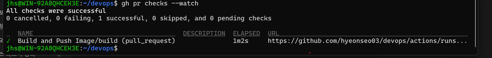
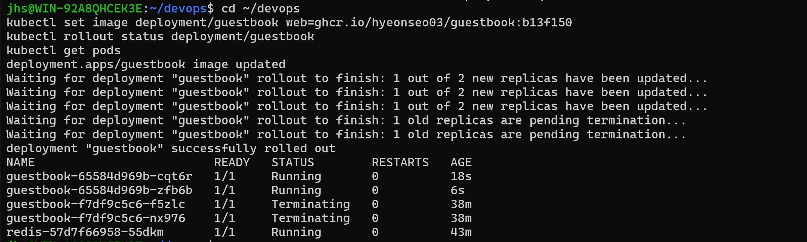
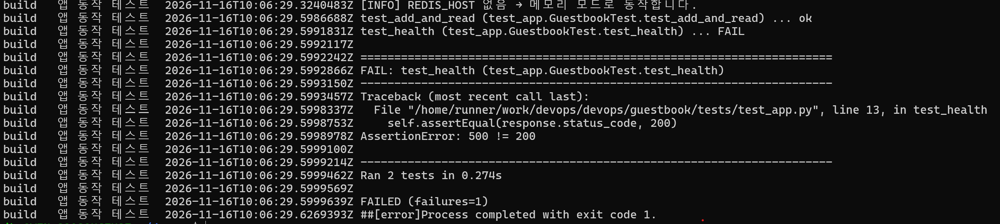
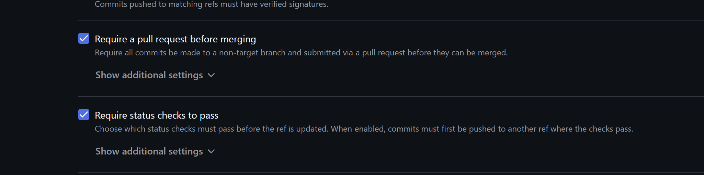
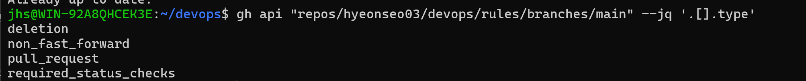
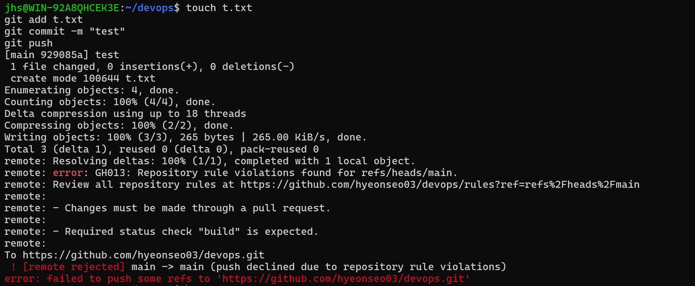
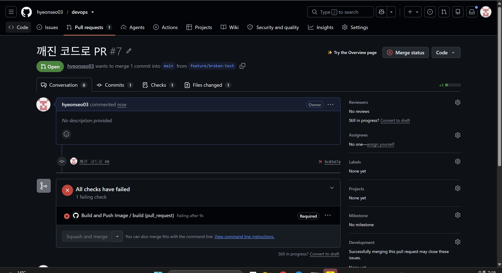
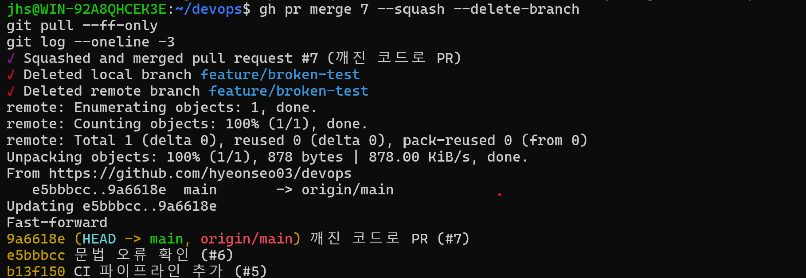

# 12주차 - 깃허브 액션 (CI)

지금까지는 코드를 고치면 `docker build` → `docker push` → `kubectl set image`를 내가 직접 쳤다.
이번 주는 이 중 검사, 테스트, 빌드, 푸시를 깃허브 액션에 맡겼다. 코드를 PR로 올리고 머지만 하면 이미지가 GHCR에 알아서 올라간다.
그리고 일부러 코드를 세 번 망가뜨려서 빨간X가 어디서 뜨는지 보고, main 브랜치 보호 규칙까지 걸어 깨진 코드가 아예 main에 못 들어오게 만들었다.

<br>

## 파일 위치

```
devops/
├── .github/workflows/build.yml    # 워크플로 (저장소 루트!)
└── guestbook/
    ├── tests/test_app.py          # /healthz 확인, 글 등록 후 조회 확인
    └── templates/index.html       # 확인용으로 제목 뒤에 new 추가
```

<br>

## 1. 푸시 전에 내 컴퓨터에서 먼저 확인

깃허브에 올리기 전에 같은 파이썬 3.12 컨테이너에서 린트랑 테스트를 먼저 돌려봤다.

```bash
cd ~/devops/guestbook
docker run --rm -v "$PWD":/app -w /app -e PYTHONDONTWRITEBYTECODE=1 python:3.12-slim \
  sh -c "pip install -q ruff -r requirements.txt && ruff check . --select=E9,F --no-cache && python -m unittest discover -s tests -v"
```

`All checks passed!`, 테스트 2개 `ok`가 나왔다. `REDIS_HOST`가 없어서 메모리 모드로 테스트한다.


<br>

## 2. 첫 워크플로: PR → 머지 → 이미지 자동 생성

`feature/ci-setup` 브랜치에서 `build.yml`, `test_app.py`를 넣고, 화면 확인용으로 `index.html`의 제목 뒤에 `new`를 붙였다.

```bash
git add .github guestbook/tests guestbook/templates
git commit -m "CI 파이프라인 추가"
git push -u origin feature/ci-setup
gh pr create --fill
gh pr checks --watch
```

PR #5에서 검사가 1분 2초 만에 통과했다. PR에서는 아직 main에 안 합쳐진 코드라서 빌드까지만 하고 이미지는 안 올린다.



머지하니까 main에 push가 일어나서 워크플로가 한 번 더 돌았다. 요약 화면에 `Triggered via push`, 커밋 `b13f150`, 브랜치 `main`, 총 1분 9초로 나온다.


main 실행을 열어보면 단계가 순서대로 다 통과했다. 코드 검사 5초, 테스트 2초로 빨리 끝나는 것부터 하고, 제일 오래 걸리는 빌드 & 푸시(36초)는 마지막이다.
PR 때는 건너뛰었던 `ghcr.io 로그인`이 main에서는 실행됐다.


<br>

## 3. GHCR에 올라간 이미지 확인

패키지 페이지에 `latest`와 `b13f150` 태그가 한 줄에 붙은 새 버전이 생겼다. `b13f150`은 머지 커밋의 앞 7자리라서 이 이미지가 어떤 코드로 만들어졌는지 바로 알 수 있다.
그 아래 `v2`, `v1`은 6주차에 내가 직접 `docker push`로 올린 것이고, 이번 건 나는 `git push`랑 머지만 했다.


latest는 계속 덮어써지니까 나중에 되돌릴 땐 해시 태그를 보면 될 것 같다.

<br>

## 4. CI가 만든 이미지를 쿠버네티스에 적용

```bash
kubectl set image deployment/guestbook web=ghcr.io/hyeonseo03/guestbook:b13f150
kubectl rollout status deployment/guestbook
```

10주차처럼 Pod가 하나씩 교체됐고, 11주차에 넣은 readiness 프로브를 통과한 다음에 옛 Pod가 내려갔다.



브라우저에서 제목이 "현서의 방명록 v2 (k8s) new"로 바뀌었다.
앞부분이랑 주황색은 ConfigMap 값 그대로고, 뒤에 붙은 `new`만 이번에 CI가 빌드한 이미지에서 온 것이다. 저장소도 계속 Redis다.


이 마지막 `set image`는 아직 내가 손으로 쳤다. 다음 주에 ArgoCD를 쓰면 이 부분도 자동이 된다고 한다.

<br>

## 5. 빨간X 세 번 → 초록✓

`feature/ci-errors` 브랜치로 PR #6을 열고 같은 브랜치에서 세 가지를 차례로 망가뜨렸다.

### (1) 문법 오류

```bash
echo "def broken(:" >> guestbook/app.py
```

코드 검사(Lint) 단계에서 바로 멈췄다. 로그를 아래에서부터 보면 `exit code 1` → `Found 2 errors` → `app.py:137:12` → `invalid-syntax` 순서로 원인이 나온다.
여기서 멈춰서 테스트랑 빌드는 아예 안 돌았다.


마지막 줄을 지우고 다시 push하니 초록✓로 돌아왔다.


### (2) 오타 (린트)

`index()` 함수 안에 `print(APP_TITL)`을 넣었다. `APP_TITLE`에서 E 하나를 뺀 오타다.
`python3 -m compileall`로 문법 검사를 해보면 `0`(통과)이 나온다. 파이썬 문법으로는 아무 문제가 없다.
그런데 ruff는 `F821 Undefined name 'APP_TITL'`, `app.py:89:11`로 정확히 그 글자를 짚었다.


이대로 배포됐다면 첫 화면에 들어가는 순간 500 에러가 났을 것이다. 린트는 코드를 실행하지 않고도 이걸 찾았다.

### (3) 테스트 실패

`git revert HEAD`로 오타를 되돌리고, 이번엔 `/healthz`가 200 대신 500을 돌려주게 바꿨다.
문법도 맞고 오타도 없어서 코드 검사는 통과했는데, 앱 동작 테스트에서 `AssertionError: 500 != 200`으로 걸렸다.



이게 그대로 배포됐으면 11주차에 건 liveness 프로브가 `/healthz`를 보고 계속 실패해서 Pod가 무한 재시작했을 것이다.
다시 revert하고 초록✓가 된 뒤에 PR #6을 머지했다.


| 실험 | 넣은 코드 | 걸린 단계 | 메시지 |
|---|---|---|---|
| 문법 오류 | `def broken(:` | 코드 검사 | `invalid-syntax` |
| 오타 | `print(APP_TITL)` | 코드 검사 | `F821 Undefined name` |
| 동작 오류 | `/healthz` → 500 | 앱 동작 테스트 | `500 != 200` |

<br>

## 6. main 브랜치 보호 (룰세트)

Settings → Rules → Rulesets에서 `main-protect` 룰세트를 만들었다.

- 대상: 기본 브랜치(main)
- Require a pull request before merging (승인 수 0, 혼자라서)
- Require status checks to pass → `build`



```bash
gh api "repos/hyeonseo03/devops/rules/branches/main" --jq '.[].type'
# deletion / non_fast_forward / pull_request / required_status_checks
```

삭제 금지, 강제 push 금지, PR 필수, `build` 검사 필수 네 가지가 걸려 있다.



확인하려고 main에서 `t.txt`를 커밋해서 바로 push해 봤더니 거부됐다.
`Changes must be made through a pull request`, `Required status check "build" is expected` 두 줄이 나왔다. 내 저장소인데도 막혔다.



테스트 커밋은 `git reset --hard origin/main`으로 지웠다.

<br>

## 7. 깨진 코드로 PR → 머지 버튼 잠김

`feature/broken-test` 브랜치에 `def broken2(:`를 넣고 PR #7을 열었다.
검사가 9초 만에 실패했고, 검사 옆에 `Required`가 붙어 있으면서 Squash and merge 버튼이 회색으로 잠겼다.



마지막 줄을 지우고 push한 뒤 검사가 통과하니까 머지가 됐다. `git log`에 `깨진 코드로 PR (#7)`, `문법 오류 확인 (#6)`, `CI 파이프라인 추가 (#5)`가 순서대로 쌓였다.



빨간X만 뜨고 머지가 되면 의미가 없으니까, 보호 규칙까지 같이 걸어야 하는 것 같다.

<br>

## 내 말로 정리하면

- CI는 내가 치던 검사, 테스트, 빌드를 깃허브 서버가 대신 해주는 것. 중간에 하나라도 실패하면 거기서 멈춘다.
- 성공/실패는 출력 내용이 아니라 종료 코드로만 본다. 0이면 ✓, 아니면 X.
- GHCR 로그인은 `GITHUB_TOKEN`이 알아서 해줘서 비밀번호를 따로 안 넣었다.

<br>

## 막혔던 것

**1. `.github` 폴더를 `.git` 폴더로 착각함**
탐색기로 `build.yml`을 넣으려다가 `.git` 폴더를 열었다. `.git`은 커밋 기록이 들어 있는 곳이라 건드리면 안 되고, 워크플로는 `.github/workflows/`에 넣어야 한다.
헷갈려서 `mkdir -p .github/workflows`로 만들고 `cp`로 옮겼다.

**2. 워크플로 파일 push 권한**
워크플로 파일은 GitHub CLI 토큰에 `workflow` 권한이 있어야 올라간다고 해서 `gh auth refresh -s workflow`로 브라우저에서 승인했다. 처음에 코드를 복사하다 Ctrl+C를 눌러서 한 번 다시 했다.

**3. PR 실행 이름이 전부 "문법 오류 확인"**
`gh run view --log-failed` 목록에서 오타 실험도, 테스트 실험도 이름이 다 "문법 오류 확인"이라 헷갈렸다. PR 실행은 커밋 메시지가 아니라 PR 제목으로 표시돼서 그렇다. 시간(몇 초 전)으로 구분했다.

**4. 검사가 끝나기 전에 머지했다가 거부됨**
PR #7을 고치고 push하자마자 `gh pr merge`를 쳤더니 `the base branch policy prohibits the merge`가 떴다. 검사가 아직 도는 중이었다. `gh pr checks 7 --watch`로 초록✓를 확인하고 다시 머지했다.
안내에 `--admin`을 쓰라고 나오는데, 그러면 규칙을 무시하는 거라 안 썼다.

**5. 제출하다가 README가 빠지고 태그가 먼저 붙음**
이 README를 올릴 때 파일 이름을 잘못 써서 `cp`가 실패했는데 모르고 이미지만 PR로 올렸다. 그리고 검사가 끝나기 전에 머지랑 태그를 한 줄로 이어서 쳐서, 머지는 거부됐는데 `week12` 태그만 머지 전 커밋에 붙어 버렸다.
`git push origin --delete week12`로 태그를 지우고, README를 추가로 push한 다음 머지가 끝난 main에 다시 태그를 달았다. 명령어를 여러 줄 붙여넣을 때는 앞에서 실패해도 뒤가 계속 실행된다는 걸 알았다.

<br>

## 느낀 점

docker build, push를 안 쳤는데 패키지에 이미지가 생겨 있어서 신기했다.
일부러 세 번 망가뜨려 보니까 문법 오류랑 오타는 검사에서, healthz 500은 테스트에서 걸려서 린트랑 테스트를 왜 따로 두는지 알 것 같았다.
근데 테스트가 지금 2개밖에 없어서 다른 데가 고장 나면 못 잡을 것 같다.
